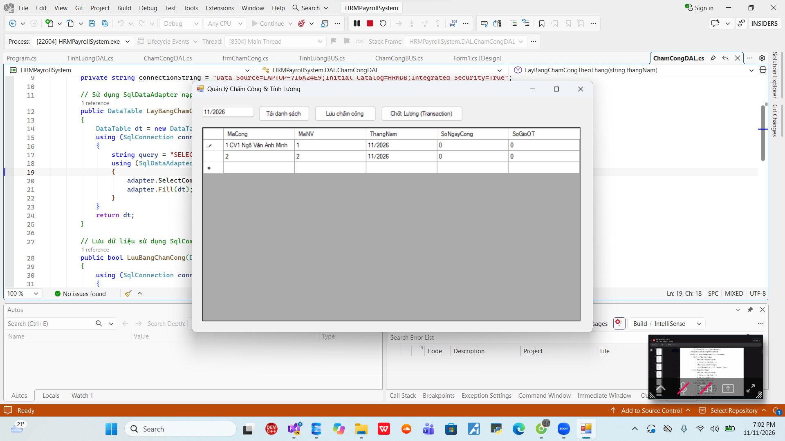
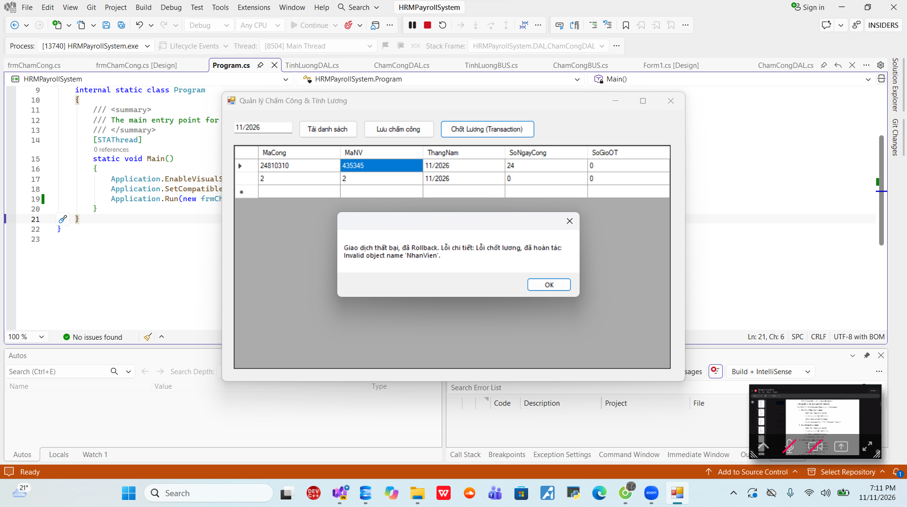

# Hệ thống Quản lý Nhân sự & Tính lương (HRM & Payroll System)

## MỤC 1: THÔNG TIN SINH VIÊN
- **Họ và tên sinh viên**: [Ngô Văn Anh Minh]
- **Mã sinh viên**: [24810310426]
- **Lớp / Khóa**: [d19cnpm5]

---

## MỤC 2: HÌNH ẢNH KẾT QUẢ CÁC MÀN HÌNH CHỨC NĂNG

*(Dưới đây là các vị trí để chèn ảnh sau khi chạy ứng dụng)*

1. **Màn hình Chính / Tổng quan hệ thống**:

2. **Màn hình Quản lý Danh mục (CRUD - Thêm/Sửa/Xóa)**:

3. **Màn hình Thực thi Nghiệp vụ chính (Chấm công)**:

4. **Màn hình Báo cáo - Thống kê**:

5. **Minh họa An toàn Dữ liệu (Báo lỗi Transaction Rollback)**:

---

## Tính năng nổi bật
- Áp dụng kiến trúc 3-Tier (DTO - DAL - BUS - GUI).
- Sử dụng mô hình **Disconnected Model** (`SqlDataAdapter`, `DataTable`, `SqlCommandBuilder`) để nhập dữ liệu bảng chấm công tiện lợi trên DataGridView.
- Thực thi **SqlTransaction** tính lương để đảm bảo không bị thất thoát, sai lệch dữ liệu.
